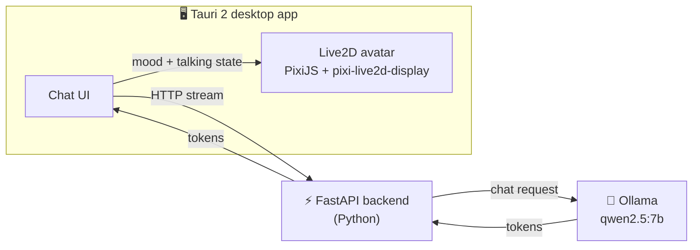

<div align="center">

# ✨ NIMO

### A local AI chatbot with an animated Live2D avatar, as a desktop app.

Talk to **Mao**. She answers in real time, moves her mouth while she speaks, and changes expression to match her mood. Everything runs on your own machine, with no cloud and no API keys.

<br />


</div>

---

## 🌸 Features

- 💬 **Streaming chat**: replies appear word by word as Qwen generates them
- 🧑‍🎤 **Animated Live2D avatar**: Mao blinks, breathes, and follows your cursor with her eyes
- 👄 **Lip sync**: her mouth moves while a reply streams and closes when it ends
- 🎭 **Mood-driven expressions**: the model tags each reply with a mood, and Mao's face changes to match
- 🔒 **Fully local**: the model runs on your machine through [Ollama](https://ollama.com), so nothing leaves your computer
- 🪟 **Native desktop app** built with Tauri 2: small, fast, and Windows-friendly
- 📐 **Responsive layout**: the avatar rescales and stays centered when you resize the window

---

## 🧠 How it works



**The mood system.** The backend's system prompt asks Qwen to begin every reply with one tag such as `[happy]`. The frontend reads the tag from the stream, hides it from the chat bubble, and switches Mao's expression. A few seconds after she finishes talking, she returns to neutral. If the model forgets the tag, she simply stays neutral.

| Mood tag | Expression |
| --- | --- |
| `[neutral]` | Normal |
| `[happy]` | Happy |
| `[excited]` | Excited |
| `[sad]` | Sad |
| `[embarrassed]` | Blushing |
| `[shocked]` | Shocked |
| `[angry]` | Angry |

---

## 🧰 Tech stack

| Layer | Technology |
| --- | --- |
| Desktop shell | [Tauri 2](https://tauri.app) (Rust + system WebView) |
| Frontend | Vanilla HTML / CSS / JavaScript |
| Avatar rendering | [PixiJS](https://pixijs.com) **v6.5.10** + [pixi-live2d-display](https://github.com/guansss/pixi-live2d-display) **0.4.0** |
| Avatar model | Live2D Cubism, *Niziiro Mao* (official sample model) |
| Backend | Python, [FastAPI](https://fastapi.tiangolo.com), uvicorn, httpx |
| LLM runtime | [Ollama](https://ollama.com) with **Qwen 2.5 7B** |

---

## 📁 Project structure

```
NIMO/
├── backend/
│   ├── main.py              # FastAPI server: /chat (streaming), /health, /reset
│   └── chat_cli.py          # Terminal chat for testing the model without the UI
├── app/
│   ├── src/
│   │   ├── index.html       # Layout
│   │   ├── styles.css
│   │   ├── main.js          # Chat logic, streaming, mood parsing
│   │   ├── avatar.js        # Live2D setup, lip sync, expressions
│   │   ├── vendor/          # pixi.min.js, cubism4.min.js, + Cubism Core (see below)
│   │   └── models/mao/      # Mao model files (see below)
│   └── src-tauri/           # Tauri / Rust side
└── README.md
```

---

## 🚀 Getting started

### Prerequisites

- [Ollama](https://ollama.com/download) with the model pulled:
  ```powershell
  ollama pull qwen2.5:7b
  ```
- [Python](https://www.python.org/downloads/) 3.10 or newer
- [Node.js](https://nodejs.org) 20 or newer
- [Rust](https://rustup.rs)
- **Windows only:** Microsoft C++ Build Tools (*Desktop development with C++*). WebView2 is already included in Windows 10 and 11.

See the [Tauri prerequisites](https://tauri.app/start/prerequisites/) for other platforms.

### 1. Clone

```powershell
git clone https://github.com/<your-username>/<your-repo>.git
cd <your-repo>
```

### 2. Backend

```powershell
cd backend
python -m venv .venv
.\.venv\Scripts\Activate.ps1
pip install fastapi "uvicorn[standard]" httpx
uvicorn main:app --reload --port 8000
```

Check it at <http://localhost:8000/health>, or open <http://localhost:8000/docs> to try the API. Leave this terminal running.

### 3. Live2D assets (required, not included in this repo)

Live2D's licence does not allow redistributing the Cubism Core or the sample models, so you need to add them yourself:

1. Download the **Cubism SDK for Web** from the [Live2D website](https://www.live2d.com/en/sdk/download/web/). **Use version R4.** See the [notes below](#-important-notes) for why.
2. Copy these two things into the app:

   | From the SDK | To |
   | --- | --- |
   | `Core/live2dcubismcore.min.js` | `app/src/vendor/` |
   | `Samples/Resources/Mao/` (the whole folder) | `app/src/models/mao/` |

3. The model entry point must end up at `app/src/models/mao/Mao.model3.json`.

> `pixi.min.js` and `cubism4.min.js` should already be in `app/src/vendor/`. If they are missing, run `npm install pixi.js@6.5.10 pixi-live2d-display@0.4.0` inside `app/` and copy `node_modules/pixi.js/dist/browser/pixi.min.js` and `node_modules/pixi-live2d-display/dist/cubism4.min.js` into `app/src/vendor/`.

### 4. Run the desktop app

In a **second** terminal (a clean one, without the Python venv active):

```powershell
cd app
npm install
npm run tauri dev
```

The first run compiles the Rust side and takes a few minutes. Later runs are fast.

---

## ⚠️ Important notes

- **Use the Cubism Core from SDK R4.** The R5 Core crashes at draw time with `pixi-live2d-display 0.4.0` (`Cannot read properties of undefined` inside `doDrawModel`), because the newer SDK changed the framework this library was built against.
- **Keep PixiJS on v6.** `pixi-live2d-display` does not work with PixiJS v7 or later.
- **Mao's mouth** is driven through the model's own *LipSync* parameter group, read from `Mao.model3.json` at startup. Not every model uses the standard `ParamMouthOpenY`.
- **Two terminals are required for now.** The backend has to be running before you start the app. Packaging it into the app is on the roadmap.
- **Small models are not perfect.** Qwen 2.5 7B occasionally forgets the mood tag. When that happens, Mao stays neutral.

---

## 🛠️ Troubleshooting

| Problem | Likely fix |
| --- | --- |
| `Could not determine Node.js install directory` | Your PATH mixes two Node installs (for example Laragon's and the official one). Put `C:\Program Files\nodejs\` first, and run `npm` from a fresh terminal. |
| `link.exe not found` when building | Install the C++ build tools (*Desktop development with C++*). |
| Avatar panel stays blank | Open DevTools with `Ctrl+Shift+I` and read the Console. Check the vendor scripts and the model path. |
| `Could not find Cubism 4 runtime` | `live2dcubismcore.min.js` is missing from `app/src/vendor/` or loads after the other scripts. |
| The chat shows "Can't reach the backend" | The backend isn't running on port 8000, or Ollama isn't running. |
| Mao is off-center or cropped | Make sure you are on the current `avatar.js`, which sizes the canvas with a `ResizeObserver`. |

---

## 🗺️ Roadmap

- [x] Python backend with streaming chat (FastAPI + Ollama)
- [x] Tauri 2 desktop shell with chat UI
- [x] Live2D avatar (Mao) with a responsive layout
- [x] Lip sync while replies stream
- [x] Mood-driven expressions
- [ ] Clear error messages when Ollama is not running or the model is missing
- [ ] "New chat" and "Stop generating" buttons
- [ ] Persona and settings in a config file
- [ ] Bundle the Python backend as a Tauri sidecar for one-click launch
- [ ] Persistent chat history
- [ ] Body motions and gestures

---

## 🙏 Credits and licensing

- Avatar: **Niziiro Mao**, an official sample model by [Live2D Inc.](https://www.live2d.com), used under the Live2D Free Material License. It is **not** included in this repository.
- The **Live2D Cubism Core** is proprietary software by Live2D Inc. and is **not** included in this repository. Review the [Live2D licence terms](https://www.live2d.com/en/sdk/license/) before distributing anything built with it.
- [pixi-live2d-display](https://github.com/guansss/pixi-live2d-display) by guansss, [PixiJS](https://pixijs.com), [Tauri](https://tauri.app), [FastAPI](https://fastapi.tiangolo.com), [Ollama](https://ollama.com), and [Qwen](https://github.com/QwenLM/Qwen2.5) by Alibaba Cloud.

The code in this repository (everything except the Live2D files above) is released under the **MIT License**.

---

<div align="center">

Built by **Jac** as a first step into agentic AI development 🚀

</div>
